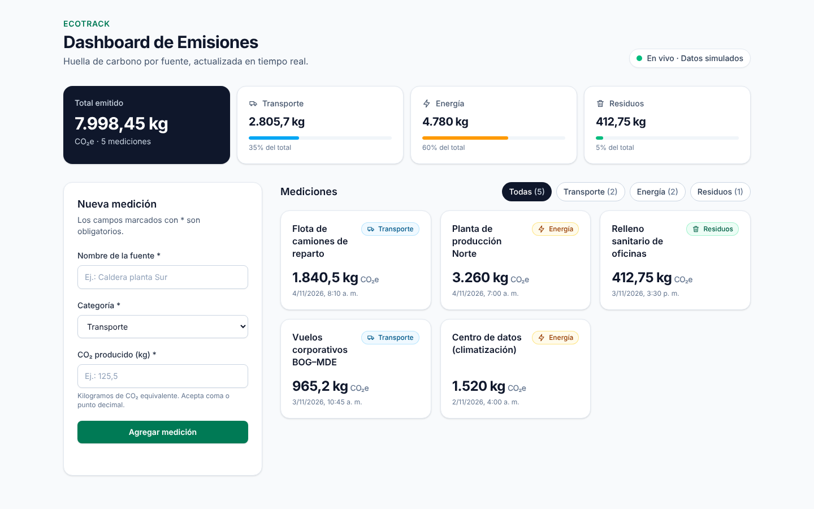
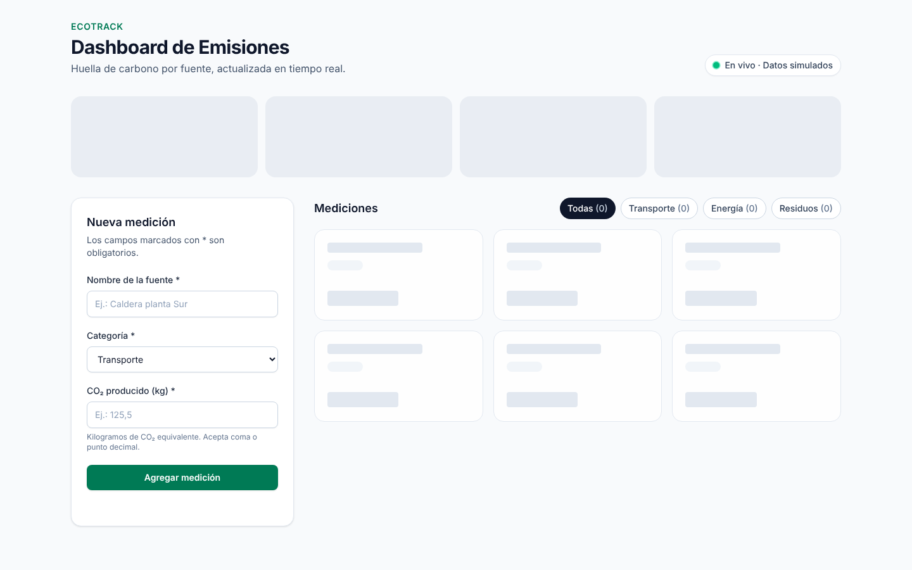
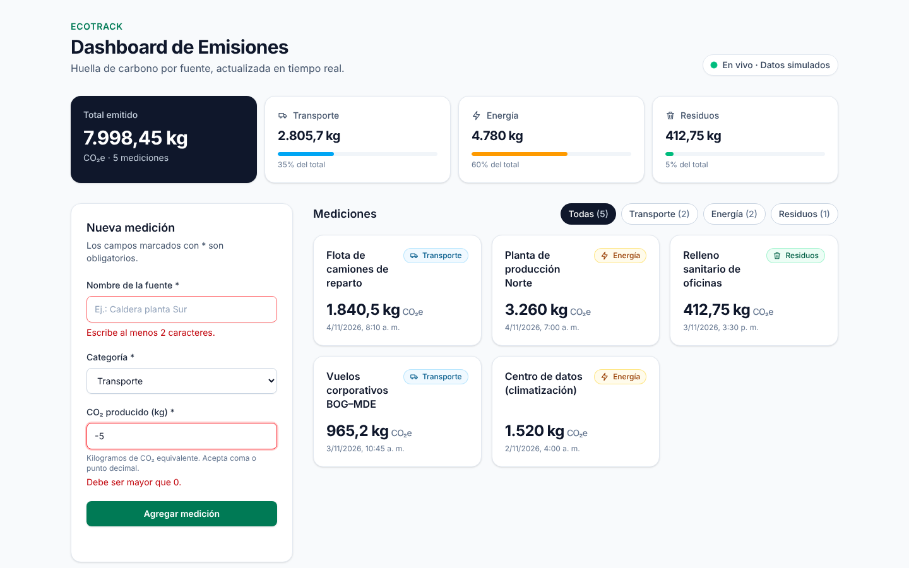
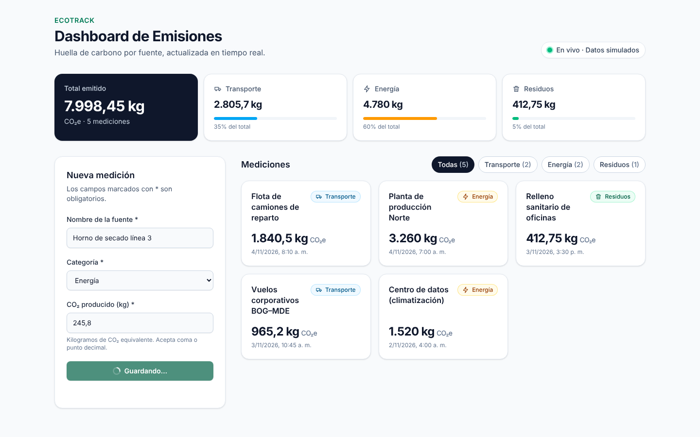
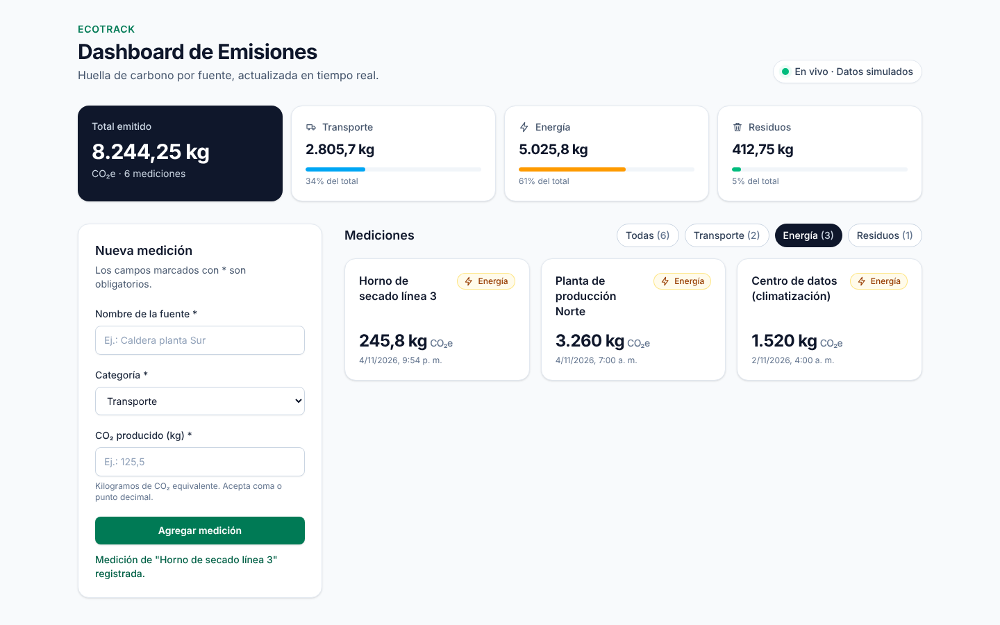
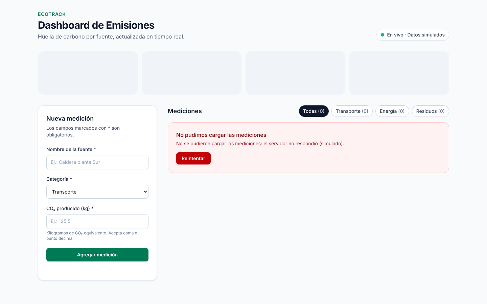
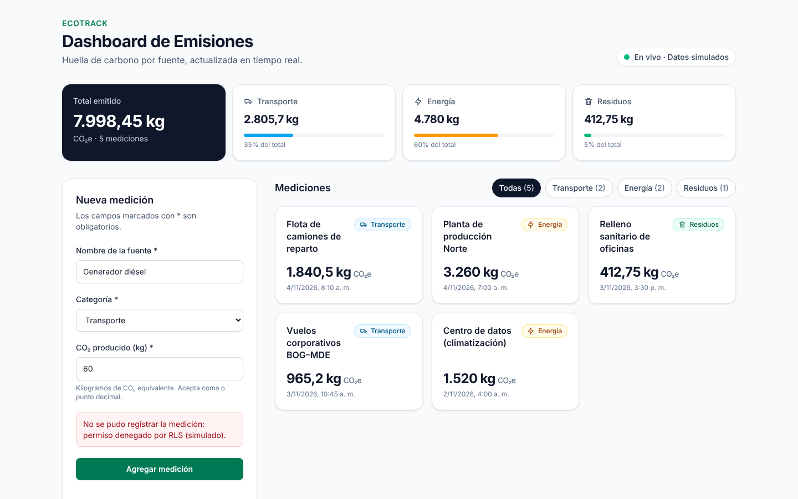
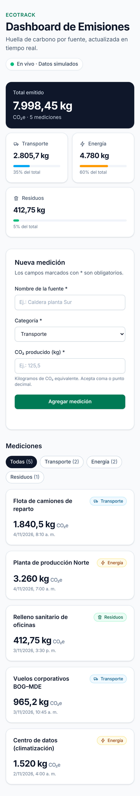

# 1. Especificación de partida

| Requisito | Detalle |
|---|---|
| Componente | `EmissionsTracker` |
| Visualización | Tarjetas con nombre de la fuente, categoría (Transporte, Energía, Residuos) y CO₂ producido |
| Interactividad | Formulario para agregar nuevas mediciones |
| Estado | Custom hook `useEmissions` que gestiona carga, inserción y errores con Supabase |
| Diseño | Tailwind CSS, *responsive* y con *feedback* claro (loaders, errores) |

**Stack usado:** React 19, TypeScript 7 en modo estricto, Vite 8, Tailwind CSS 4, `@supabase/supabase-js` 2 y Vitest 5. Las respuestas a los prompts las generó Claude (Anthropic).

## Resumen de la evolución

| Iteración | Prompt | Qué produjo la IA | Problemas detectados que motivaron el siguiente prompt |
|---|---|---|---|
| v1 | Estructura | Un solo componente con Supabase adentro | `any` (2 errores de lint), sin carga ni errores, sin `label`, el CO₂ se enviaba como texto, grilla fija de 3 columnas |
| v2 | Lógica | Hook `useEmissions` con `loading` y `error` | El *loader* de inserción borraba toda la pantalla, el error nunca se limpiaba, no se cancelaban respuestas tardías, `categoria: string`, aviso de lint `set-state-in-effect` |
| v3 | Refinamiento | `useReducer`, tipos estrictos, accesibilidad, `useMemo` y `memo` | Faltaba el "tiempo real" que pedía el nombre del dashboard |
| v4 | Tiempo real + pruebas | Suscripción a Supabase Realtime, eliminación de duplicados y 13 pruebas | Versión final. Una prueba confirmó el bug de duplicados de v3 y su corrección |

Las versiones intermedias se guardaron sin modificar en `docs/iteraciones/` como evidencia.

# 2. Prompt 1: Estructura

```text
Actúa como arquitecto frontend senior con experiencia en React, TypeScript y Supabase.

Contexto: EcoTrack es una plataforma de monitoreo de huella de carbono para empresas.
El backend ya tiene en Supabase la tabla `emisiones` (id uuid, nombre_fuente text,
categoria text: 'transporte' | 'energia' | 'residuos', co2_kg numeric, medido_en timestamptz).

Especificación del componente `EmissionsTracker`:
- Listado de tarjetas con: nombre de la fuente, categoría y CO2 producido.
- Formulario para agregar nuevas mediciones.
- Estilos con Tailwind CSS.

Tarea: propón la arquitectura de componentes para esta especificación (árbol de
componentes y responsabilidad de cada uno) y entrega una primera versión funcional
del componente en un proyecto Vite + React + TypeScript.
```

**Resultado (v1, extracto):** la IA propuso un árbol razonable (`EmissionsTracker → EmissionForm + EmissionList → EmissionCard`), pero el código entregó todo en un solo archivo:

```tsx
const supabase = createClient(import.meta.env.VITE_SUPABASE_URL, import.meta.env.VITE_SUPABASE_ANON_KEY)

export default function EmissionsTracker() {
  const [emissions, setEmissions] = useState<any[]>([])
  useEffect(() => {
    supabase.from('emisiones').select('*').then(({ data }) => setEmissions(data || []))
  }, [])
  const handleSubmit = async (e: any) => {
    await supabase.from('emisiones').insert({ nombre_fuente: name, categoria: category, co2_kg: co2 })
    ...
```

**Evaluación (verificada con `oxlint`, ver `docs/iteraciones/lint_v1_v2.log`):**

1. Dos usos de `any` (líneas 12 y 23): se pierde el tipado de TypeScript.
2. El cliente de Supabase se crea dentro del archivo del componente, lo que mezcla datos con UI.
3. No hay estado de carga ni de error. Si la consulta falla, la lista queda vacía en silencio.
4. Se ignora el error del `insert`, y `co2_kg` se envía como texto, sin validación.
5. Los `input` solo tienen `placeholder`, sin `label` (incumple WCAG 1.3.1 y 3.3.2).
6. `grid-cols-3` es fijo, así que en móvil las tarjetas se comprimen.

# 3. Prompt 2: Lógica (`useEmissions`)

```text
Refactoriza el código anterior. Problemas detectados: Supabase se usa dentro del
componente, no hay estados de carga ni error y se usa `any`.

Crea un custom hook `useEmissions` que:
1. Cargue las mediciones de la tabla `emisiones` al montarse.
2. Exponga `emissions`, `loading` y `error`.
3. Exponga `addEmission(medicion)` que inserte en Supabase y actualice la lista.
4. Maneje los errores de Supabase y los muestre en la UI.
Mueve el cliente de Supabase a `src/lib/supabaseClient.ts` y define una interfaz
`Emission`. El componente solo debe consumir el hook.
```

**Resultado (v2, extracto):**

```ts
const addEmission = async (emission: Omit<Emission, 'id'>) => {
  setLoading(true)
  const { error } = await supabase.from('emisiones').insert(emission)
  if (error) setError(error.message)
  await fetchEmissions()
}
// En el componente:
if (loading) return <p>Cargando...</p>
if (error) return <p className="text-red-600">{error}</p>
```

**Evaluación:**

1. **Un solo `loading` para todo:** al guardar, el `return` temprano reemplaza toda la pantalla, incluido el formulario. El usuario pierde el contexto.
2. **Error permanente:** `setError` nunca vuelve a `null`. Tras un fallo, la pantalla de error queda fija.
3. **Sin cancelación:** si el componente se desmonta durante la petición, se actualiza el estado de un componente que ya no existe.
4. **Petición extra:** se vuelve a pedir toda la tabla después de cada inserción.
5. **Tipos débiles:** `categoria: string` acepta cualquier texto y el modelo usa nombres de la base de datos (`co2_kg`) dentro de la UI.
6. **Lint:** aviso `react(set-state-in-effect)` en la línea 27, y `total` se recalcula en cada render.

# 4. Prompt 3: Refinamiento (restricciones profesionales)

```text
Refina el hook y los componentes con estas restricciones:

TypeScript estricto
- Sin `any`. Activa `strict`, `noUncheckedIndexedAccess` y `exactOptionalPropertyTypes`.
- La categoría es un union type ('transporte' | 'energia' | 'residuos'), no string.
- Separa el modelo de dominio (camelCase) de la fila de BD (snake_case) con un mapper.

Estado asíncrono
- Usa useReducer con estados explícitos: 'loading' | 'success' | 'error'.
- Separa el estado de carga de la lista del estado de envío del formulario
  (isSubmitting, submitError) para no ocultar la UI al guardar.
- Ignora respuestas que lleguen después de desmontar el componente.
- Expón reload() para reintentar y clearSubmitError().
- El hook depende de una interfaz EmissionsRepository (no de Supabase directamente)
  para poder usar datos simulados en la demo y en las pruebas.

Rendimiento
- Calcula los totales por categoría con useMemo.
- Envuelve EmissionCard y el resumen en React.memo.
- Agrega un filtro por categoría derivado con useMemo (sin estado duplicado).

Accesibilidad y UX
- Cada campo con <label> asociado, aria-invalid y aria-describedby para errores.
- Al enviar con errores, mueve el foco al primer campo inválido.
- Anuncia éxito con role="status" y errores con role="alert".
- Skeleton de carga, estado vacío y error con botón "Reintentar".
- Diseño responsive con Tailwind: 1 columna en móvil, 2 en tablet, 3 en escritorio.
```

**Resultado (v3):** el hook pasó a un *reducer* con acciones tipadas. La UI ya no desaparece al guardar porque la carga y el envío tienen estados separados:

```ts
type Action =
  | { type: 'load/start' } | { type: 'load/success'; emissions: Emission[] }
  | { type: 'load/error'; error: string }
  | { type: 'add/start' } | { type: 'add/success'; emission: Emission }
  | { type: 'add/error'; error: string } | { type: 'submitError/clear' }

const totals = useMemo<EmissionTotals>(() => { /* total y por categoría */ }, [state.emissions])
```

Además, la validación quedó en una función pura (`validateEmission`) que acepta coma decimal. El formulario usa `useId` para los `id` accesibles, y `EmissionCard` está envuelto en `memo`. El archivo está en `docs/iteraciones/v3/useEmissions.ts`.

# 5. Prompt 4: Tiempo real y pruebas

```text
El dashboard se llama "en Tiempo Real". Agrega al hook una suscripción a Supabase
Realtime (postgres_changes, evento INSERT en public.emisiones) que inserte en la
lista las mediciones creadas por otros clientes, y cancela la suscripción al
desmontar.

Ten en cuenta que Realtime también notifica al cliente que hizo el INSERT. Antes de
corregirlo, demuestra el problema con una prueba y luego evita los duplicados.

Escribe pruebas con Vitest y Testing Library para: carga exitosa, error y reintento,
inserción, error de inserción, evento en tiempo real, estabilidad de useMemo,
validación del formulario y foco en el primer campo inválido.
```

**Bug demostrado antes de corregir.** Se agregó a v3 la suscripción sin deduplicar y la prueba falló (log en `iteraciones/prueba_duplicados_v3.log`):

```text
× v3 + Realtime sin deduplicar: la medición propia aparece una sola vez
AssertionError: expected [ …(2) ] to have a length of 1 but got 2
```

**Corrección (v4, versión final):**

```ts
/** Inserta sin duplicar: la misma fila puede llegar por la respuesta del INSERT y por Realtime. */
function upsert(list: Emission[], emission: Emission): Emission[] {
  if (list.some((item) => item.id === emission.id)) return list
  return [emission, ...list]
}

useEffect(
  () => repository.subscribe((emission) => dispatch({ type: 'realtime/insert', emission })),
  [repository],
)
```

**Verificación final:**

| Comando | Resultado |
|---|---|
| `npm run build` (`tsc -b` + Vite) | Sin errores de tipos |
| `npm run lint` (oxlint) | 0 avisos y 0 errores |
| `npm test` (Vitest) | 13 de 13 pruebas pasan, en 3 archivos |
| Consola del navegador durante las capturas | 0 errores |

# 6. Arquitectura final

```text
src/
├── components/emissions/
│   ├── EmissionsTracker.tsx   ← compone hook + UI; filtro con useMemo
│   ├── EmissionForm.tsx       ← formulario accesible y validado
│   ├── EmissionCard.tsx       ← tarjeta (React.memo)
│   ├── EmissionsSummary.tsx   ← totales por categoría (React.memo)
│   ├── Feedback.tsx           ← skeleton, error con reintento, vacío
│   └── categoryMeta.ts / CategoryIcon.tsx
├── hooks/useEmissions.ts      ← carga, inserción, errores, tiempo real
├── services/emissionsRepository.ts  ← Supabase + simulado (misma interfaz)
├── lib/supabaseClient.ts      ← cliente único
├── types/emission.ts          ← modelo de dominio y union de categorías
└── utils/validation.ts, format.ts
supabase/migrations/20261105000000_crear_emisiones.sql  ← tabla, RLS y Realtime
```

**Regla de dependencias:** la UI solo usa el hook, el hook solo usa la interfaz `EmissionsRepository` y solo `services/` conoce Supabase. Si no hay variables `VITE_SUPABASE_*`, la app usa el repositorio simulado. Ese modo tiene latencia de 700 ms, emite una medición nueva cada 15 s (tiempo real) y puede forzar errores con `?simular=error-carga` o `?simular=error-insercion` en la URL.

# 7. Capturas de la demostración

Video completo: `docs/capturas/demo_dashboard.mp4` (19 s). Muestra la carga, los filtros, la validación, la inserción y la llegada de una medición en tiempo real.

{width=100%}

{width=49%} {width=49%}

{width=49%} {width=49%}

{width=49%} {width=49%}

{width=32%}

# 8. Ejecución y alcance

1. `npm install`
2. Opcional: copia `.env.example` a `.env.local` con `VITE_SUPABASE_URL` y `VITE_SUPABASE_ANON_KEY`, y aplica `supabase/migrations/20261105000000_crear_emisiones.sql` en tu proyecto.
3. `npm run dev`

**Alcance:** la demostración usa el repositorio simulado porque no había un proyecto de Supabase disponible. La implementación con Supabase tiene la misma interfaz, compila y su migración SQL se probó en PostgreSQL 16, pero no se ejecutó contra un proyecto real. Las políticas RLS de la migración permiten acceso con la *anon key* solo para la demo. En producción deben limitarse a usuarios autenticados de cada empresa.
